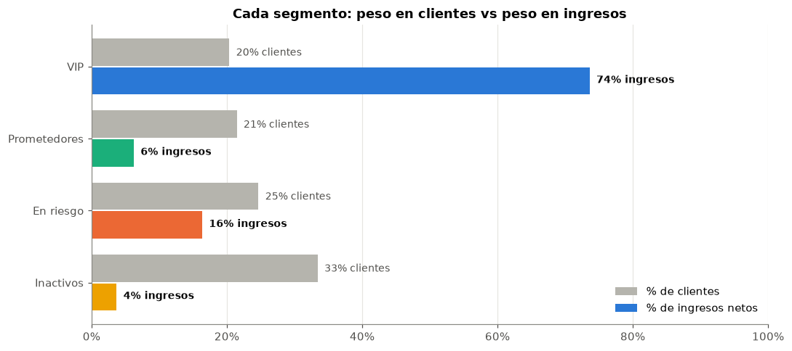
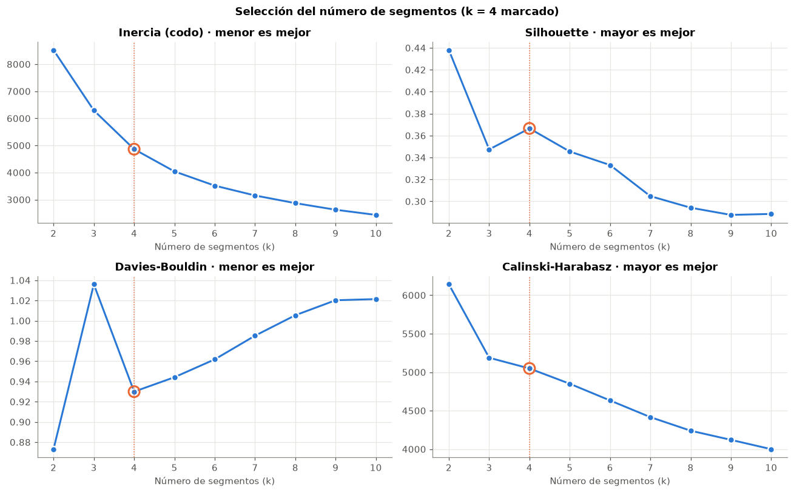
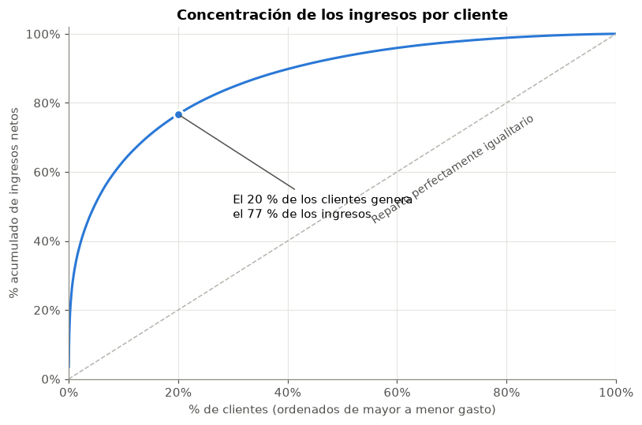
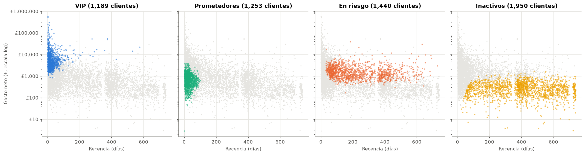

# Plataforma de inteligencia de clientes · Segmentación RFM con K-Means

Proyecto de *data science* de principio a fin sobre **1 millón de transacciones reales** de un e-commerce británico: desde el Excel original hasta una segmentación de clientes lista para que marketing la use, pasando por una base de datos SQL, la ingeniería de variables y un modelo de clustering validado.

> **Pregunta de negocio:** ¿qué tipos de clientes tenemos, quiénes generan el valor y a quién debemos intentar retener primero?



## Resultados principales

| Segmento | Clientes | % ingresos | Recencia mediana | Pedidos (mediana) | Gasto mediano | Estrategia |
|---|---:|---:|---:|---:|---:|---|
| **VIP** | 1.189 (20 %) | **74 %** | 17 días | 13 | 4.809 £ | Fidelizar, trato preferente, sin descuentos masivos |
| **Prometedores** | 1.253 (21 %) | 6 % | 24 días | 3 | 705 £ | Convertir en habituales (*onboarding*, segunda compra) |
| **En riesgo** | 1.440 (25 %) | 16 % | 185 días | 4,5 | 1.432 £ | **Reactivar ya**: campaña personalizada priorizada por valor |
| **Inactivos** | 1.950 (33 %) | 4 % | 402 días | 1 | 267 £ | Recuperación automática y de bajo coste |

- **El 20 % de los clientes (VIP) genera el 74 % de los ingresos netos.** Perder a uno de ellos cuesta lo mismo que perder a decenas de clientes medios.
- El segmento **En riesgo** reúne **2,7 M£ de gasto histórico**: es donde una acción de retención tiene más retorno. El proyecto entrega una **lista priorizada** de estos clientes ordenada por valor.
- Se detectan **62 VIP "enfriándose"** (llevan más del doble de su tiempo habitual sin comprar), con 820.000 £ de gasto histórico: una alerta temprana de abandono.
- La segmentación es **estable**: ARI ≈ 1,00 entre semillas y ≈ 0,98 entrenando con submuestras.

## Cómo está construido

```
Excel original (1,07 M filas)
   │  01 · Exploración: calidad de datos, cancelaciones, estacionalidad
   ▼
Limpieza + base de datos SQLite (794 K líneas, 4 tablas relacionales)
   │  02 · Duplicados, clientes sin ID, códigos no producto, validación con SQL
   ▼
Tabla de clientes (5.832 clientes × 15 variables)
   │  03 · RFM + comportamiento con SQL (CTEs, funciones ventana) y pandas
   ▼
Segmentación K-Means (4 segmentos) + acciones de negocio
      04 · Elección de k, estabilidad, perfiles, priorización, modelo guardado
```

| Notebook | Qué hace | Decisiones clave |
|---|---|---|
| [01 · Exploración](plataforma-inteligencia-clientes/notebooks/01_exploracion_datos.ipynb) | Calidad de los datos, ventas, cancelaciones, estacionalidad y primer perfil de clientes | Identificar qué hay que limpiar y por qué |
| [02 · Limpieza y base de datos](plataforma-inteligencia-clientes/notebooks/02_limpieza_datos.ipynb) | Limpieza documentada paso a paso y creación de una base de datos **SQLite** normalizada | Las dos hojas del Excel **se solapan 9 días** → duplicados; se excluyen portes y ajustes; las cancelaciones se guardan aparte |
| [03 · Feature engineering](plataforma-inteligencia-clientes/notebooks/03_construccion_features.ipynb) | Una fila por cliente: recencia, frecuencia, gasto **neto**, ticket medio, tiempo entre compras... | Gasto **neto** (un cliente "gastaba" 168.000 £ pero lo canceló todo); log para las distribuciones sesgadas |
| [04 · Segmentación](plataforma-inteligencia-clientes/notebooks/04_segmentacion_clientes.ipynb) | K-Means sobre RFM, validación, interpretación y recomendaciones | k = 4 según codo, silhouette y Davies-Bouldin; RFM supera a conjuntos con más variables |

Todos los notebooks explican **qué se hace y por qué** en cada paso.

### Algunas decisiones técnicas destacadas

- **Detección del solape entre hojas del Excel** (1-9 dic. 2010), que duplicaba transacciones e inflaba el gasto de los clientes.
- **Gasto neto en lugar de bruto:** sin restar cancelaciones, clientes con pedidos de más de 100.000 £ cancelados aparecían entre los mejores clientes.
- **Modelo relacional en SQLite** con claves primarias, foráneas e índices, y validación cruzada SQL vs pandas de los totales.
- **SQL analítico:** CTEs para la agregación por cliente y `LAG()` para calcular los días entre compras consecutivas.
- **Transformación logarítmica + estandarización** dentro de un `Pipeline` de scikit-learn, de modo que el modelo guardado segmenta clientes nuevos con el mismo preprocesado.
- **Elección de k con cuatro métricas** (inercia, silhouette, Davies-Bouldin, Calinski-Harabasz) y criterio de negocio (tamaño mínimo de segmento).
- **Validación de estabilidad** con Adjusted Rand Index entre semillas y submuestras.
- **Nombres de segmento asignados por reglas** a partir de los perfiles (no a mano), para que sobrevivan a un reentrenamiento.

<p align="center">
  
  
</p>



## Estructura del repositorio

```
plataforma-inteligencia-clientes/
├── Esquema.md                       # Planteamiento del proyecto: preguntas, variables, modelo de datos
├── data/
│   ├── raw/online_retail_II.xlsx    # Datos originales (no se modifican)
│   └── processed/
│       ├── online_retail.db         # Base de datos SQLite (se genera con el notebook 02)
│       ├── features_clientes.csv    # Tabla de features por cliente (notebook 03)
│       └── segmentos_clientes.csv   # Segmento asignado a cada cliente (notebook 04)
├── models/
│   └── segmentacion_kmeans.joblib   # Pipeline log + escalado + K-Means entrenado
├── notebooks/
│   ├── 01_exploracion_datos.ipynb
│   ├── 02_limpieza_datos.ipynb
│   ├── 03_construccion_features.ipynb
│   └── 04_segmentacion_clientes.ipynb
├── reports/figures/                 # Gráficos principales
└── requirements.txt
```

## Cómo reproducirlo

```bash
git clone https://github.com/LauraMontoliuPeris/plataforma-inteligencia-clientes.git
cd plataforma-inteligencia-clientes/plataforma-inteligencia-clientes
python -m venv .venv
.venv\Scripts\activate          # Windows  (en macOS/Linux: source .venv/bin/activate)
pip install -r requirements.txt
jupyter lab
```

Ejecuta los notebooks en orden (01 → 04). El notebook 02 genera la base de datos `online_retail.db` (no se incluye en el repositorio por su tamaño); los notebooks 03 y 04 trabajan sobre ella.

## Datos

[Online Retail II](https://archive.ics.uci.edu/dataset/502/online+retail+ii), UCI Machine Learning Repository (Chen, D., 2012). Transacciones de una tienda online británica de regalos entre el 01/12/2009 y el 09/12/2011. Licencia CC BY 4.0.

## Limitaciones y próximos pasos

- El análisis cubre solo a clientes registrados (~77 % de las transacciones originales) y es una foto fija a diciembre de 2011; en producción se recalcularía periódicamente.
- K-Means asume grupos aproximadamente esféricos y los clientes forman un continuo: los clientes en la frontera entre segmentos son los menos seguros.
- **Siguiente fase:** modelo supervisado de **predicción de churn** (probabilidad de abandono por cliente, con ventanas de observación y predicción) y estimación del **Customer Lifetime Value**, para priorizar las acciones de retención según *riesgo × valor*.

## Tecnologías

Python · pandas · NumPy · SQL (SQLite) · scikit-learn · matplotlib · seaborn · Jupyter

---

**Laura Montoliu Peris** · [GitHub](https://github.com/LauraMontoliuPeris)
